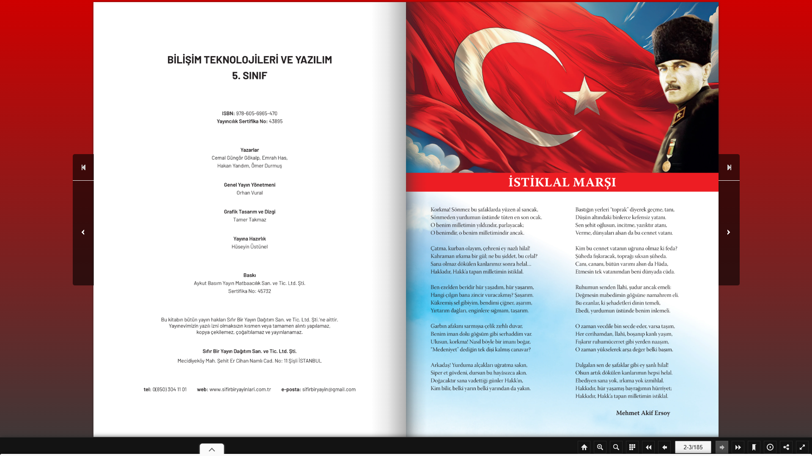

# PubHTML5 Cloner

> Turn a PubHTML5 flipbook into an offline PDF with Selenium screenshots, Pillow crops and a small PDF builder.

[](https://www.python.org/)
[](https://www.selenium.dev/)
[](LICENSE)

<p align="center">
  <a href="https://www.buymeacoffee.com/cmtrkr"></a>
</p>

PubHTML5 Cloner is a three-stage Python workflow for archiving a flipbook you have the right to download. It opens the book in Chrome, captures each spread, crops the two pages, sorts them naturally and writes a single PDF.

It is a personal archiving utility, not a bulk scraper. Respect copyright and the site's terms.

## 📸 Sample output

<p align="center">
  
  <br>
  <sub>A real sample spread produced by the capture stage (`data/sayfa_1.png`).</sub>
</p>

## 🧩 How it works

```text
main.py       → Selenium opens the flipbook, clicks through pages, saves screenshots to data/
app.py        → Pillow crops each screenshot into left/right pages in kesilmis_jpg/
pdfmaker.py   → natsort + Pillow combine the JPGs into output.pdf
```

### 1. Capture

Edit `main.py`:

- `driver.get("...")` — the flipbook URL
- the click XPath and the `range(92)` page count
- the sleep durations for your connection speed

```bash
python3 main.py
```

Screenshots land in `data/`. If an ad opens, close it manually during the initial wait.

### 2. Crop

Adjust the two crop boxes in `app.py` to match your screen resolution:

```python
alan1 = (222, 5, 950, 1026)     # left page
alan2 = (970, 5, 1700, 1026)    # right page
```

```bash
python3 app.py
```

Cropped pages go to `kesilmis_jpg/`.

### 3. Build the PDF

```bash
python3 pdfmaker.py
# → output.pdf
```

## 📋 Requirements

- Python 3.8+
- Google Chrome
- A ChromeDriver matching your Chrome version
- `selenium`, `pillow`, `natsort`

```bash
python3 -m pip install --user selenium pillow natsort
```

The repository includes `chromedriver.exe` for Windows. On macOS/Linux, download the matching driver or use `webdriver-manager`.

## 📁 Project structure

```text
├── main.py          # Selenium capture
├── app.py           # Pillow cropping
├── pdfmaker.py      # Natural sort + PDF assembly
├── chromedriver.exe # Windows driver (replace for your OS)
├── data/            # Captured spreads
└── kesilmis_jpg/    # Cropped pages (created at runtime)
```

## ⚠️ Notes and legal use

- Only archive content you own or have permission to download.
- Flipbook layouts and XPaths change; update the selectors and crop coordinates when needed.
- Output quality depends on the browser window and screen resolution. Larger windows produce sharper pages.
- The script waits fixed durations. Increase them if pages load slowly.
- This project is not affiliated with PubHTML5.

## ❤️ Support

If this workflow saves you time, you can buy me a coffee:

<p align="center">
  <a href="https://www.buymeacoffee.com/cmtrkr"></a>
</p>

## 📄 License

[MIT](LICENSE) © 2026 Cem Türker.
